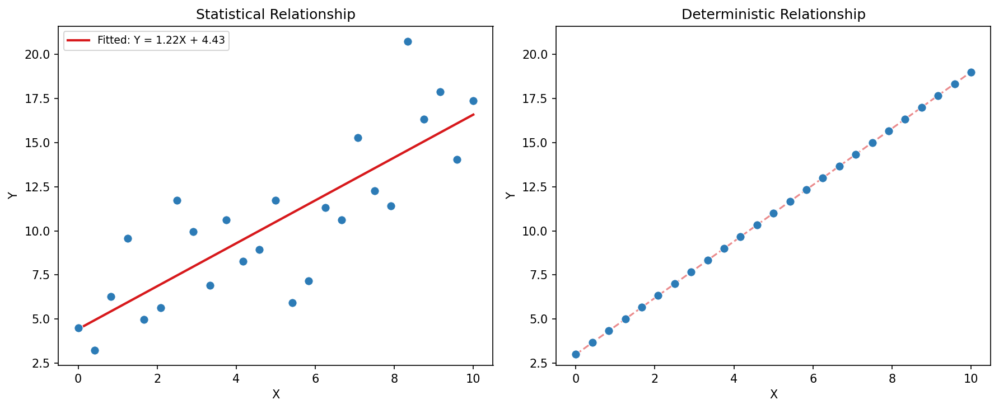
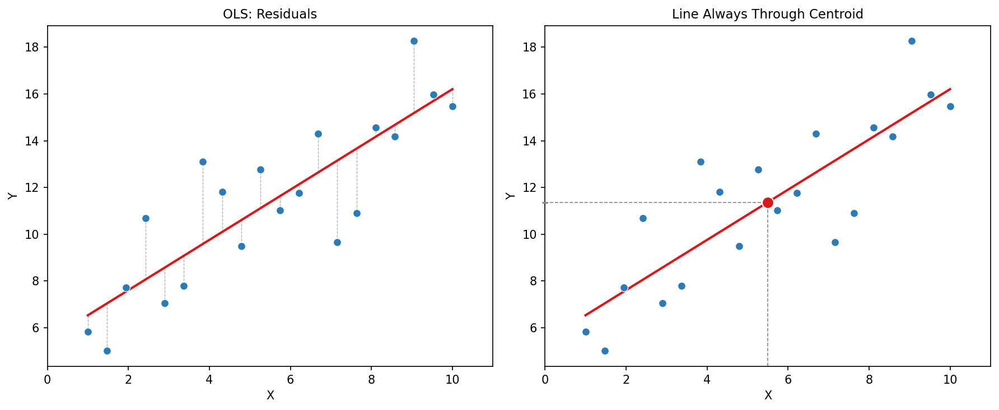
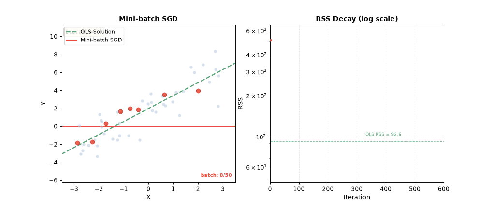
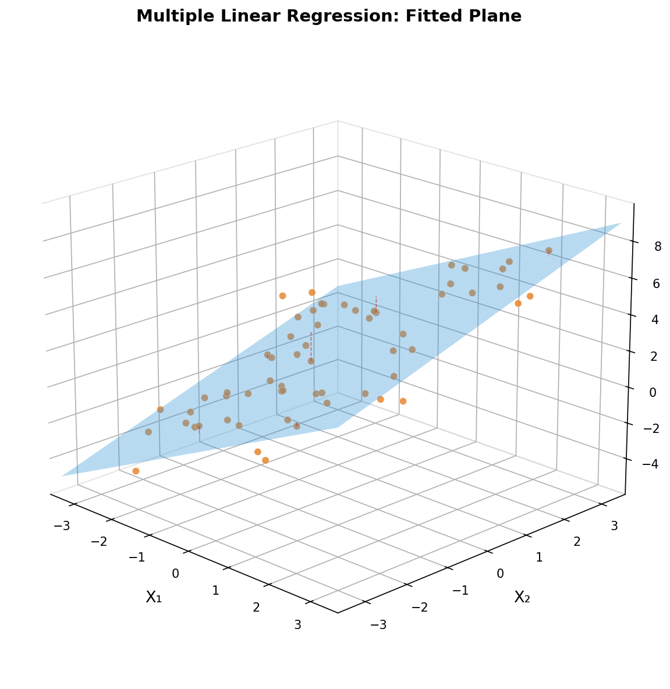

---
title: "Linear Model"
collection: learning
permalink: /learning/2026-09-07-linear-model
excerpt: 'OLS, Gauss-Markov, finite-sample distributions, inference and model selection - with proofs'
date: 2026-09-07
tags: [linear-model, statistics, least-squares, regression, gauss-markov, statistical-inference, model-selection, 机器学习]
---

## 1. The Linear Model: Idea and Motivation

### 1.1 Deterministic vs Statistical Relationships

Relationships between variables fall into two categories. A **deterministic relationship** is one where the response can be expressed as an exact mathematical function of the predictors — no randomness involved. For example, given a circle's radius $r$, its area $A = \pi r^2$ is perfectly determined: knowing $r$ gives $A$ without error.

A **statistical relationship**, by contrast, is one where the response is not perfectly predictable. Observed values scatter around an underlying trend, and the deviations are captured by a random error term:

$$
Y = f(X) + \varepsilon
$$

$f(X)$ is the systematic component (e.g. $\beta_0 + \beta_1 X$), and $\varepsilon$ is the random component. Measurement error, omitted variables, and inherent variability all contribute to this randomness.

This distinction is fundamental because it shifts the goal from exact calculation to **inference** — estimating parameters, quantifying uncertainty, and making probabilistic statements.

### 1.2 Identifying Statistical Relationships: The Scatterplot

The most direct tool for detecting a statistical relationship is the **scatterplot**.

Three telltale signs:

- **A visible trend** — as $X$ increases, $Y$ tends to increase or decrease systematically, suggesting $f(X)$
- **Spread around the trend** — points deviate from any single curve; the signature of $\varepsilon$
- **No perfect fit** — no smooth function passes through all points exactly

Once a statistical relationship is visually confirmed, the next step is to model it — and the linear model is the natural starting point.

### 1.3 The Simple Linear Regression Model

Formalizing the above, the **simple linear regression model** assumes:

$$
Y_i = \beta_0 + \beta_1 X_i + \varepsilon_i, \quad i = 1, \dots, n
$$

Component meanings:

- $\beta_0$ (**intercept**): the expected value of $Y$ when $X = 0$; anchors the line vertically
- $\beta_1$ (**slope**): the expected change in $Y$ for a one-unit increase in $X$; captures the strength and direction of the linear association
- $\varepsilon_i$ (**random error**): everything affecting $Y_i$ beyond the linear function of $X_i$ — factors the model omits, errors in observing the variables itself, **specification error** (choosing the wrong functional form), and genuinely random influences

$\beta_0 + \beta_1 X_i$ is the **systematic component** (the explained part); $\varepsilon_i$ is the **stochastic component** (the unexplained part). The statistical problem: given $n$ pairs of observations $(X_i, Y_i)$, estimate $\beta_0$ and $\beta_1$. Section 2 derives the estimator; Section 3 asks whether it is any good.

## 2. Ordinary Least Squares Estimation

### 2.1 The OLS Principle and Scalar Derivation

**Ordinary least squares** (OLS) chooses the line that minimizes the sum of squared vertical distances:

$$
\hat{\beta}_0, \hat{\beta}_1 = \arg\min_{\beta_0, \beta_1} \sum_{i=1}^n \bigl(Y_i - \beta_0 - \beta_1 X_i\bigr)^2
$$

Define the residual $e_i = Y_i - \hat{\beta}_0 - \hat{\beta}_1 X_i$. OLS minimizes $\sum e_i^2$.

Why squares rather than absolute values? Three reasons: (1) squares are differentiable everywhere, yielding clean closed-form solutions; (2) squaring penalizes large deviations more heavily; (3) under the Gauss-Markov assumptions (Section 3), OLS delivers optimal statistical properties.

Let $Q(\beta_0, \beta_1) = \sum_{i=1}^n (Y_i - \beta_0 - \beta_1 X_i)^2$. Differentiating:

**With respect to $\beta_0$:**

$$
\frac{\partial Q}{\partial \beta_0} = -2 \sum_{i=1}^n (Y_i - \beta_0 - \beta_1 X_i) = 0
\;\Longrightarrow\;
\hat{\beta}_0 = \bar{Y} - \hat{\beta}_1 \bar{X} \tag{2.1}
$$

The fitted line **always passes through the centroid** $(\bar{X}, \bar{Y})$.

**With respect to $\beta_1$:**

$$
\frac{\partial Q}{\partial \beta_1} = -2 \sum_{i=1}^n X_i (Y_i - \beta_0 - \beta_1 X_i) = 0
$$

Substituting (2.1) and rearranging, with $S_{XX} = \sum (X_i - \bar{X})^2$ and $S_{XY} = \sum (X_i - \bar{X})(Y_i - \bar{Y})$:

$$
\boxed{\hat{\beta}_1 = \frac{S_{XY}}{S_{XX}} = \frac{\sum (X_i - \bar{X})(Y_i - \bar{Y})}{\sum (X_i - \bar{X})^2}} \tag{2.2}
$$

(2.1) and (2.2) are the **OLS estimators** — functions of data alone, no unknown parameters.

Equivalently, in terms of the sample correlation $r_{XY}$:

$$
\hat{\beta}_1 = r_{XY} \cdot \frac{s_Y}{s_X}
$$

The estimated slope is the correlation scaled by the ratio of variabilities.

**Five algebraic properties of the fitted line.** These follow from the normal equations alone — no probabilistic assumptions whatsoever — so they hold for *any* OLS fit, good data or bad:

1. **The line passes through the centroid** $(\bar X,\bar Y)$ — this is (2.1)
2. **Fitted values share the mean of the observations**: $\overline{\hat Y} = \bar Y$, since averaging $\hat Y_i = \hat\beta_0+\hat\beta_1X_i$ gives $\hat\beta_0+\hat\beta_1\bar X = \bar Y$ by (2.1)
3. **The residuals sum to zero**: $\sum_i e_i = 0$, by subtracting property 2 from $\sum Y_i$
4. **Residuals are uncorrelated with fitted values**: $\sum_i e_i\hat Y_i = 0$, since $\sum e_i\hat Y_i = \hat\beta_0\sum e_i + \hat\beta_1\sum e_iX_i$
5. **Residuals are uncorrelated with the predictor**: $\sum_i e_iX_i = 0$

Properties 3–5 are the normal equations in disguise, and they generalize verbatim to multiple regression as $\mathbf{X}^\top\mathbf{e}=\mathbf{0}$ — the orthogonality that produces the hat matrix of Section 4.2 and the degrees-of-freedom accounting of Section 3.5. Keep them separate in your mind from the *statistical* properties of Section 3: these five are pure algebra and always true; those depend on assumptions that can fail.

### 2.2 Matrix Form and the Normal Equations

The scalar derivation is elegant but doesn't scale. Rewriting in matrix-vector form:

$$
\mathbf{y} = \mathbf{X}\boldsymbol{\beta} + \boldsymbol{\varepsilon}
$$

where $\mathbf{y} \in \mathbb{R}^n$, the design matrix $\mathbf{X} \in \mathbb{R}^{n \times (p+1)}$ has a leading column of 1s for the intercept, and $\boldsymbol{\beta} \in \mathbb{R}^{p+1}$. The residual sum of squares becomes the squared $\ell_2$-norm:

$$
\text{RSS}(\boldsymbol{\beta}) = \|\mathbf{y} - \mathbf{X}\boldsymbol{\beta}\|_2^2 = (\mathbf{y} - \mathbf{X}\boldsymbol{\beta})^\top (\mathbf{y} - \mathbf{X}\boldsymbol{\beta})
$$

Differentiating and setting to zero:

$$
\frac{\partial\,\text{RSS}}{\partial\boldsymbol{\beta}} = -2\mathbf{X}^\top(\mathbf{y} - \mathbf{X}\boldsymbol{\beta}) = \mathbf{0}
\;\Longrightarrow\;
\boxed{\mathbf{X}^\top\!\mathbf{X}\,\hat{\boldsymbol{\beta}} = \mathbf{X}^\top\mathbf{y}}
$$

These are the **normal equations**. When $\mathbf{X}^\top\!\mathbf{X}$ is invertible (columns of $\mathbf{X}$ are linearly independent — no perfect multicollinearity), the closed-form solution is:

$$
\boxed{\hat{\boldsymbol{\beta}} = (\mathbf{X}^\top\!\mathbf{X})^{-1}\mathbf{X}^\top\mathbf{y}} \tag{2.3}
$$

For simple regression ($p=1$), expanding (2.3) reproduces the scalar estimators exactly. But the real power of this form is generality: it holds for any number of predictors, serving as the unified algebraic framework behind multiple regression, polynomial regression, and basis expansions.

### 2.3 Gradient Descent: An Iterative Alternative

The closed form requires inverting $\mathbf{X}^\top\!\mathbf{X}$ at a cost of $O(p^3)$. When $p$ is large — millions of features in genomics or text modelling — this is prohibitive. **Gradient descent** offers an alternative.

Starting from an initial guess $\boldsymbol{\beta}^{(0)}$ (often zeros), repeatedly step downhill:

$$
\boldsymbol{\beta}^{(t+1)} = \boldsymbol{\beta}^{(t)} - \alpha \nabla \text{RSS}(\boldsymbol{\beta}^{(t)})
$$

where the learning rate $\alpha > 0$ controls step size, and $\nabla \text{RSS} = -2\mathbf{X}^\top(\mathbf{y} - \mathbf{X}\boldsymbol{\beta})$.

Two practical variants:

- **Batch Gradient Descent**: computes the gradient over all $n$ observations. Converges smoothly but is expensive per iteration for large $n$
- **Stochastic Gradient Descent (SGD)**: uses a single observation (or a small mini-batch) per step, trading gradient accuracy for speed. This noisy-but-cheap update is the foundation of modern deep-learning optimisation

The choice between closed-form and gradient descent:

| | Closed-Form $(\mathbf{X}^\top\!\mathbf{X})^{-1}\mathbf{X}^\top\mathbf{y}$ | Gradient Descent |
|---|---|---|
| **Cost** | $O(np^2 + p^3)$, one-time | $O(np)$ per iteration |
| **Large $p$** | Intractable | Works |
| **Large $n$** | Fine | Use SGD |
| **Exact** | Yes | Approximate |
| **Requires invertibility** | Yes (or regularise) | No |
| **Extensible** | Limited | Naturally extends to Lasso, Ridge, neural nets |

In classical statistics with modest $p$, the closed form is preferred — exact and directly tied to inference. In machine learning with large $p$, or when the linear model sits inside a larger optimisation pipeline, gradient descent is the default. Both arrive at the same $\hat{\boldsymbol{\beta}}$ of (2.3); only the path differs.

## 3. Statistical Properties of the OLS Estimators

Section 2 treated OLS as a purely algebraic procedure: minimize a sum of squares, read off a number. But a number computed from a random sample is itself **random** — draw a different sample and the estimate moves. Everything valuable OLS supports (standard errors, hypothesis tests, confidence intervals) rests on knowing the **sampling distribution** of $\hat\beta_0$ and $\hat\beta_1$: where it is centered, how far it spreads, whether any competing procedure spreads less, and what shape it has.

This section establishes those properties, and does two things beyond merely stating them: **each result is proved**, and **each proof tracks exactly which assumptions it consumes**. That second habit matters more than any individual formula. When an assumption fails on real data you need to know precisely which conclusions survive and which collapse — and Section 7 exists because some of these assumptions always fail.

Throughout, all expectations and variances are **conditional on the observed predictors** $\mathbf{X} = (X_1,\dots,X_n)$ — the *fixed-design* view appropriate for controlled experiments, and the cleanest language for these results. With random sampling it extends immediately via $\mathbb{E}[\cdot] = \mathbb{E}_{\mathbf{X}}[\mathbb{E}[\cdot\mid\mathbf{X}]]$.

The road map:

| Property | Result | Assumptions consumed | Section |
|---|---|---|---|
| Unbiasedness | $\mathbb{E}[\hat\beta_j]=\beta_j$ | Linearity, exogeneity, no perfect collinearity | 3.2 |
| Variance / covariance | $\operatorname{Var}(\hat\beta_1)=\sigma^2/S_{XX}$, etc. | + homoskedasticity, no autocorrelation | 3.3 |
| Efficiency (BLUE) | minimum variance among linear unbiased estimators | all five | 3.4 |
| Variance estimation | $\mathbb{E}[\text{RSS}/(n-2)]=\sigma^2$ | homoskedasticity, no autocorrelation | 3.5 |
| Exact finite-sample distribution | Normal; Student-$t$ | + normal errors | 3.6 |
| Large-sample properties | consistency, asymptotic normality | substantially weakened | 3.7 |
| MLE equivalence | $\hat{\boldsymbol\beta}^{\text{MLE}}=\hat{\boldsymbol\beta}^{\text{OLS}}$ | + normal errors | 3.8 |

Notice the gradient before it is obscured by algebra: **unbiasedness costs almost nothing, while optimality and exact inference cost progressively more.** That ordering is the single most useful thing to carry out of this section.

### 3.1 The Gauss-Markov Assumptions

The OLS formulas of Section 2 are algebra — they minimize $\sum e_i^2$ under no probabilistic model at all. To say *why* OLS is a good estimator we must specify a data-generating process. The **Gauss-Markov assumptions**:

1. **Linearity**: $Y_i = \beta_0 + \beta_1 X_i + \varepsilon_i$
2. **Strict exogeneity**: $\mathbb{E}[\varepsilon_i \mid X_1,\dots,X_n] = 0$
3. **Homoskedasticity**: $\operatorname{Var}(\varepsilon_i \mid X_1,\dots,X_n) = \sigma^2$ for all $i$
4. **No autocorrelation**: $\operatorname{Cov}(\varepsilon_i, \varepsilon_j \mid X_1,\dots,X_n) = 0$ for $i \neq j$
5. **No perfect collinearity**: the $X_i$ are not all identical ($S_{XX} > 0$)

A few comments that pay off later:

- **Assumptions 1–2 are structural** — they say the model is correctly specified. Violating them (omitted variables, wrong functional form, simultaneity) makes OLS *biased*, which is fatal and cannot be repaired by collecting more data.
- **Assumptions 3–4 concern second moments only.** Violating them leaves OLS unbiased but destroys $\operatorname{Var}(\hat\beta_j) = \sigma^2/S_{XX}$ and therefore invalidates the usual standard errors. This is repairable — see Section 7.
- **Assumption 5 is a data condition**, verifiable by inspection, unlike 1–4.
- **Normality is nowhere on the list.** The entire Gauss-Markov apparatus is distribution-free; normality is bolted on separately in Sections 3.6 and 3.8, and only there.

### 3.2 Unbiasedness

The most basic property an estimator can have: it is right *on average*.

> **Definition.** $\hat\beta$ is **unbiased** for $\beta$ if $\mathbb{E}[\hat\beta\mid\mathbf{X}] = \beta$ for every admissible value of $\beta$, for all $n$. The difference $\mathbb{E}[\hat\beta] - \beta$ is the **bias**.

Two clarifications that prevent misreadings. Unbiasedness says nothing about *this* sample's estimate — a particular $\hat\beta_1$ is either right or wrong, and usually wrong; the property is about the center of the sampling distribution, i.e. what happens on average over infinitely many hypothetical replications. And it is a **finite-sample** claim, stronger than consistency.

#### Step 1: OLS is a linear estimator

Everything follows from rewriting OLS as a linear combination of the responses. From (2.2), note that $\sum(X_i-\bar X)(Y_i-\bar Y) = \sum(X_i-\bar X)Y_i$ because the leftover term is $\bar Y\sum(X_i-\bar X) = 0$. Hence:

$$
\boxed{\hat\beta_1 = \sum_{i=1}^n c_i Y_i, \qquad c_i = \frac{X_i - \bar X}{S_{XX}}} \tag{3.1}
$$

The OLS slope is a weighted sum of the $Y_i$. This single identity is why every property below is provable in three or four lines. It is also the **linearity** property in its own right: $\hat\beta_1$ is a linear function of the responses. The standard checklist for an estimator is three finite-sample properties — linearity (established here), unbiasedness (Section 3.2) and efficiency (Section 3.4) — plus one large-sample property, consistency (Section 3.7). Three consequences of the weights, all immediate:

$$
\sum_{i=1}^n c_i = \frac{\sum(X_i-\bar X)}{S_{XX}} = 0 \tag{3.2}
$$

$$
\sum_{i=1}^n c_i X_i = \frac{\sum(X_i-\bar X)X_i}{S_{XX}} = \frac{\sum(X_i-\bar X)^2}{S_{XX}} = 1 \tag{3.3}
$$

$$
\sum_{i=1}^n c_i^2 = \frac{\sum(X_i-\bar X)^2}{S_{XX}^2} = \frac{1}{S_{XX}} \tag{3.4}
$$

(In (3.3) we used $\sum(X_i-\bar X)\bar X = 0$ to replace $X_i$ by $X_i-\bar X$.) For the intercept, substitute (3.1) into $\hat\beta_0 = \bar Y - \hat\beta_1\bar X$:

$$
\hat\beta_0 = \sum_{i=1}^n d_i Y_i, \qquad d_i = \frac{1}{n} - \bar X c_i \tag{3.5}
$$

with, by the same bookkeeping, $\sum d_i = 1$ and $\sum d_i X_i = 0$.

#### Step 2: Proof of unbiasedness

Assuming **linearity** (A1) and **strict exogeneity** (A2) only:

$$
\mathbb{E}[\hat\beta_1\mid\mathbf{X}] = \sum_{i=1}^n c_i\,\mathbb{E}[Y_i\mid\mathbf{X}] = \sum_{i=1}^n c_i(\beta_0 + \beta_1 X_i) = \beta_0\underbrace{\sum c_i}_{=0} + \beta_1\underbrace{\sum c_i X_i}_{=1} = \beta_1 \tag{3.6}
$$

$$
\mathbb{E}[\hat\beta_0\mid\mathbf{X}] = \sum_{i=1}^n d_i(\beta_0 + \beta_1 X_i) = \beta_0\underbrace{\sum d_i}_{=1} + \beta_1\underbrace{\sum d_i X_i}_{=0} = \beta_0
$$

$\blacksquare$

**Only A1, A2 and A5 were used.** Homoskedasticity and independence never entered. This is why OLS unbiasedness is far more robust than its competitors — break assumptions 3 or 4 and the estimates are still centered correctly, merely less precisely than advertised. Section 7 depends entirely on this distinction.

The matrix version, using only $\mathbb{E}[\boldsymbol\varepsilon\mid\mathbf{X}]=\mathbf{0}$:

$$
\mathbb{E}[\hat{\boldsymbol\beta}\mid\mathbf{X}] = (\mathbf{X}^\top\!\mathbf{X})^{-1}\mathbf{X}^\top\mathbb{E}[\mathbf{y}\mid\mathbf{X}] = (\mathbf{X}^\top\!\mathbf{X})^{-1}\mathbf{X}^\top\mathbf{X}\boldsymbol\beta = \boldsymbol\beta \tag{3.7}
$$

One line, all $p+1$ coefficients at once. Note also that $\hat{\mathbf{y}} = \mathbf{H}\mathbf{y}$ is unbiased for $\mathbf{X}\boldsymbol\beta$, and consequently $\mathbb{E}[\mathbf{e}] = \mathbf{0}$ — residuals have zero mean in expectation, hence also $\sum_i e_i = 0$ algebraically.

### 3.3 Variance and Covariance of $\hat\beta_0$ and $\hat\beta_1$

Unbiasedness locates the center of the sampling distribution; we also need its **spread**. Here assumptions A3 and A4 enter for the first time.

> **Definition.** The **standard deviation** of $\hat\beta_j$ is $\sqrt{\operatorname{Var}(\hat\beta_j)}$ — the true variability of the estimator across samples. Because it depends on the unknown $\sigma$, it is itself unknown; the **standard error** substitutes an estimate $\hat\sigma$ and is computable from data (Section 3.5, then (5.6)).

**Variance of $\hat\beta_1$.** Since $\hat\beta_1 = \sum c_iY_i$ is a linear combination, and under A3–A4 we have $\operatorname{Cov}(Y_i,Y_j\mid\mathbf{X}) = \operatorname{Cov}(\varepsilon_i,\varepsilon_j\mid\mathbf{X}) = \sigma^2$ for $i=j$ and $0$ otherwise:

$$
\operatorname{Var}(\hat\beta_1\mid\mathbf{X}) = \operatorname{Var}\!\left(\sum_i c_iY_i\,\middle|\,\mathbf{X}\right) = \sum_i\sum_j c_ic_j\operatorname{Cov}(Y_i,Y_j\mid\mathbf{X}) = \sigma^2\sum_i c_i^2 = \frac{\sigma^2}{S_{XX}} \tag{3.8}
$$

using (3.4). Now derived rather than asserted: **precision of the slope rises with the spread of $X$ and falls with noise.** Since $S_{XX} \approx n\,s_X^2$ for large $n$, the variance is roughly $\sigma^2/(n s_X^2)$ and the estimation error decays at the universal rate $O(1/\sqrt{n})$.

**Variance of $\hat\beta_0$.** With $d_i$ from (3.5):

$$
\sum_i d_i^2 = \sum_i\left(\frac{1}{n} - \bar X c_i\right)^2 = \frac{1}{n} - \frac{2\bar X}{n}\underbrace{\sum_i c_i}_{=0} + \bar X^2\underbrace{\sum_i c_i^2}_{=1/S_{XX}} = \frac{1}{n} + \frac{\bar X^2}{S_{XX}}
$$

$\operatorname{Var}(\hat\beta_0\mid\mathbf{X}) = \sigma^2\sum d_i^2$, so:

$$
\boxed{\operatorname{Var}(\hat\beta_0\mid\mathbf{X}) = \sigma^2\left(\frac{1}{n} + \frac{\bar X^2}{S_{XX}}\right)} \tag{3.9}
$$

Two additive sources of error: the $\sigma^2/n$ term is the irreducible noise in locating any level from $n$ observations; the $\bar X^2\sigma^2/S_{XX}$ term is the penalty for **extrapolating to $X=0$**, which grows the further $\bar X$ sits from the origin. This is why the intercept is often estimated poorly even when the slope is precise — it is not a defect, it is the answer to a harder question.

**Covariance.** Finally, $\operatorname{Cov}(\hat\beta_0,\hat\beta_1\mid\mathbf{X}) = \sigma^2\sum_i d_ic_i$:

$$
\sum_i d_ic_i = \sum_i\left(\frac{1}{n} - \bar X c_i\right)c_i = \frac{1}{n}\underbrace{\sum_i c_i}_{=0} - \bar X\underbrace{\sum_i c_i^2}_{=1/S_{XX}} = -\frac{\bar X}{S_{XX}}
$$

$$
\boxed{\operatorname{Cov}(\hat\beta_0,\hat\beta_1\mid\mathbf{X}) = -\,\frac{\bar X\,\sigma^2}{S_{XX}}} \tag{3.10}
$$

Read the sign carefully, because it encodes the geometry. With $\bar X > 0$ the covariance is **negative**: an over-estimated slope tends to come with an under-estimated intercept. This is no accident — from Section 2.1 the fitted line always passes through the centroid $(\bar X,\bar Y)$, so the estimates are not free to move independently. Sampling noise makes the line **pivot about the centroid**, and pivoting lifts one end while dropping the other. Equation (3.10) quantifies that intuition exactly.

This suggests a practical trick: **center the predictor.** Refit using $\tilde X_i = X_i - \bar X$; then $\bar{\tilde X} = 0$, so (3.10) gives $\operatorname{Cov} = 0$ and (3.9) collapses to $\operatorname{Var}(\hat\gamma_0) = \sigma^2/n$, while the slope — the object of interest — is numerically unchanged. Centering costs nothing and decorrelates the coefficients. Section 4.3 develops this systematically, including the standardized form used to compare predictors measured in different units.

Summarizing the bivariate sampling distribution's second moments:

$$
\operatorname{Var}\begin{pmatrix}\hat\beta_0\\ \hat\beta_1\end{pmatrix} = \sigma^2\begin{pmatrix} \dfrac{1}{n}+\dfrac{\bar X^2}{S_{XX}} & -\dfrac{\bar X}{S_{XX}}\\[8pt] -\dfrac{\bar X}{S_{XX}} & \dfrac{1}{S_{XX}}\end{pmatrix} \tag{3.11}
$$

The matrix generalization, derived identically, is the familiar $\operatorname{Var}(\hat{\boldsymbol\beta}\mid\mathbf{X}) = \sigma^2(\mathbf{X}^\top\!\mathbf{X})^{-1}$ — we will re-derive it in multiple dimensions in (5.2).

### 3.4 Efficiency: The Gauss-Markov Theorem

Unbiasedness and small variance are both desirable, but many unbiased estimators exist. The natural question: **is any unbiased estimator more precise than OLS?**

> **Definition.** $\hat\beta$ is **efficient** if it has the smallest variance among all unbiased estimators of $\beta$.

Proving efficiency against *all* unbiased estimators is usually hopeless. Gauss-Markov answers the tractable version — competing only against estimators that are **linear in $\mathbf{Y}$** — and that restriction is precisely what the theorem certifies.

> **Gauss-Markov Theorem.** Under assumptions A1–A5, the OLS estimators $\hat\beta_0$ and $\hat\beta_1$ are **BLUE**: **B**est (minimum variance) among all **L**inear **U**nbiased **E**stimators. Moreover OLS is best for *every* linear combination $v_0\beta_0 + v_1\beta_1$, including the predicted mean response at any point $x_0$.

#### Scalar proof

Let $\tilde\beta_1 = \sum_{i=1}^n w_i Y_i$ be **any** other linear estimator. The weights $w_i$ may depend on the $X_i$ in any way (that is legitimate — they are fixed once the design is realized), but not on the $Y_i$.

**Step 1 — translate unbiasedness into two constraints.** Requiring $\mathbb{E}[\tilde\beta_1\mid\mathbf{X}] = \beta_1$ to hold for *every* $(\beta_0,\beta_1)$:

$$
\mathbb{E}[\tilde\beta_1\mid\mathbf{X}] = \sum_i w_i(\beta_0 + \beta_1X_i) = \beta_0\sum_i w_i + \beta_1\sum_i w_iX_i \equiv \beta_1
$$

For this identity in $\beta_0,\beta_1$ to hold term by term, necessarily

$$
\sum_i w_i = 0 \qquad\text{and}\qquad \sum_i w_iX_i = 1 \tag{3.12}
$$

**Step 2 — decompose into OLS plus a perturbation.** Write $w_i = c_i + \delta_i$, where $c_i$ are the OLS weights of (3.1). Subtracting (3.2)–(3.3) from (3.12), the perturbation must itself satisfy

$$
\sum_i \delta_i = 0 \qquad\text{and}\qquad \sum_i \delta_iX_i = 0 \tag{3.13}
$$

**Step 3 — expand the variance.** Using $\operatorname{Cov}(Y_i,Y_j\mid\mathbf{X}) = \sigma^2\mathbb{1}\{i=j\}$ from A3–A4:

$$
\operatorname{Var}(\tilde\beta_1\mid\mathbf{X}) = \sigma^2\sum_i w_i^2 = \sigma^2\sum_i(c_i+\delta_i)^2 = \sigma^2\underbrace{\sum_i c_i^2}_{=1/S_{XX}} + \sigma^2\underbrace{\sum_i \delta_i^2}_{\geq 0} + 2\sigma^2\sum_i c_i\delta_i
$$

**Step 4 — the cross term vanishes.** This is the crux. Substituting $c_i = (X_i-\bar X)/S_{XX}$ and both parts of (3.13):

$$
\sum_i c_i\delta_i = \frac{1}{S_{XX}}\left(\sum_i X_i\delta_i - \bar X\sum_i\delta_i\right) = \frac{1}{S_{XX}}\bigl(0 - 0\bigr) = 0
$$

Therefore

$$
\boxed{\operatorname{Var}(\tilde\beta_1\mid\mathbf{X}) = \frac{\sigma^2}{S_{XX}} + \sigma^2\sum_{i=1}^n\delta_i^2 \;\geq\; \frac{\sigma^2}{S_{XX}} = \operatorname{Var}(\hat\beta_1\mid\mathbf{X})}
$$

with **equality if and only if $\delta_i = 0$ for every $i$** — that is, $\tilde\beta_1 = \hat\beta_1$. OLS is not merely tied for first place; it is uniquely the minimizer. $\blacksquare$

The identical argument applies to $\hat\beta_0$: any linear unbiased competitor has weights $v_i = d_i + \eta_i$ with $\sum\eta_i = \sum\eta_iX_i = 0$, and the cross term $\sum d_i\eta_i = \frac{1}{n}\sum\eta_i - \frac{\bar X}{S_{XX}}(\sum X_i\eta_i - \bar X\sum\eta_i) = 0$, giving $\operatorname{Var}(\tilde\beta_0) = \operatorname{Var}(\hat\beta_0) + \sigma^2\sum\eta_i^2 \geq \operatorname{Var}(\hat\beta_0)$.

#### Matrix proof, and why it is stronger

The same argument in matrix form generalizes immediately to $p$ predictors. Any linear estimator is $\tilde{\boldsymbol\beta} = \mathbf{A}\mathbf{y}$ for some $(p+1)\times n$ matrix $\mathbf{A}$ possibly depending on $\mathbf{X}$. Unbiasedness requires $\mathbf{A}\mathbf{X}\boldsymbol\beta = \boldsymbol\beta$ for all $\boldsymbol\beta$, hence $\mathbf{A}\mathbf{X} = \mathbf{I}$. Writing $\mathbf{A} = (\mathbf{X}^\top\!\mathbf{X})^{-1}\mathbf{X}^\top + \mathbf{D}$ with $\mathbf{D}\mathbf{X} = \mathbf{0}$:

$$
\operatorname{Var}(\tilde{\boldsymbol\beta}\mid\mathbf{X}) = \sigma^2\mathbf{A}\mathbf{A}^\top = \sigma^2\bigl[(\mathbf{X}^\top\!\mathbf{X})^{-1} + \mathbf{D}\mathbf{D}^\top + \mathbf{D}\mathbf{X}(\mathbf{X}^\top\!\mathbf{X})^{-1} + (\mathbf{X}^\top\!\mathbf{X})^{-1}\mathbf{X}^\top\mathbf{D}^\top\bigr]
$$

The last two terms vanish because $\mathbf{D}\mathbf{X} = \mathbf{0}$, leaving

$$
\boxed{\operatorname{Var}(\tilde{\boldsymbol\beta}\mid\mathbf{X}) = \underbrace{\sigma^2(\mathbf{X}^\top\!\mathbf{X})^{-1}}_{\operatorname{Var}(\hat{\boldsymbol\beta})} + \sigma^2\mathbf{D}\mathbf{D}^\top \;\succeq\; \operatorname{Var}(\hat{\boldsymbol\beta}\mid\mathbf{X})} \tag{3.14}
$$

where $\succeq$ denotes the positive-semidefinite order. This version is strictly more informative than the scalar one. A PSD ordering means that for **every** vector $\mathbf{v}$,

$$
\operatorname{Var}(\mathbf{v}^\top\tilde{\boldsymbol\beta}) \geq \operatorname{Var}(\mathbf{v}^\top\hat{\boldsymbol\beta})
$$

so OLS is simultaneously optimal for each coefficient *and* for the fitted value $\hat y_0 = \mathbf{x}_0^\top\hat{\boldsymbol\beta}$ at every point $\mathbf{x}_0$ — there is no efficiency trade-off to agonize over between predicting here and predicting there.

#### What BLUE does *not* promise

The theorem is often oversold. Four limits worth holding onto:

- **"Linear" is a real restriction.** The comparison class excludes nonlinear estimators of $Y$ — median-based regression, quantile regression, and others. When errors are heavy-tailed or contain outliers, such estimators can be substantially better than OLS while Gauss-Markov says nothing.
- **"Unbiased" is a real restriction.** Admitting a little bias can purchase large variance reductions. This is exactly why ridge regression and the Lasso exist (see the companion note on regularization) — they are biased by construction and routinely beat OLS on predictive accuracy.
- **"Unbiased + efficient" still does not mean optimal.** Efficiency minimizes variance, not mean squared error. In fact OLS is **inadmissible** in moderately high dimensions: by the James-Stein phenomenon, once there are three or more coefficients there exist shrinkage estimators with *uniformly smaller* total MSE than OLS. Unbiasedness comes at a price that Gauss-Markov deliberately declines to look at.
- **Break A3 or A4 and everything above is void.** The proof's Step 3 uses $\operatorname{Cov}(\mathbf{y}\mid\mathbf{X}) = \sigma^2\mathbf{I}$ essentially. Under heteroskedasticity OLS stays unbiased but is *no longer BLUE* — generalized least squares is.

### 3.5 Estimating the Error Variance

Every variance formula above contains the unknown $\sigma^2$, so none is usable until $\sigma^2$ is estimated. Since $\sigma^2 = \operatorname{Var}(\varepsilon_i)$ and $\varepsilon_i$ is unobservable, we use residuals $e_i = Y_i - \hat\beta_0 - \hat\beta_1X_i$ as stand-ins.

**Why residuals are systematic underestimates.** The residuals are *not* the errors. OLS chose $\hat\beta_0,\hat\beta_1$ specifically to make $\sum e_i^2$ as small as possible, so $\sum e_i^2 \leq \sum\varepsilon_i^2$ necessarily — the fit sits closer to the observed data than the truth does. Quantifying the gap is exactly the problem.

**Unbiasedness of $\hat\sigma^2$.** Write the residuals in vector form using the hat matrix $\mathbf{H}$ introduced in Section 4.2 — a modest forward reference, since nothing below depends on the geometric interpretation it receives there. Because $(\mathbf{I}-\mathbf{H})\mathbf{X} = \mathbf{0}$, substituting $\mathbf{y} = \mathbf{X}\boldsymbol\beta + \boldsymbol\varepsilon$ annihilates the systematic part:

$$
\mathbf{e} = (\mathbf{I}-\mathbf{H})\mathbf{y} = (\mathbf{I}-\mathbf{H})\boldsymbol\varepsilon, \qquad \mathbb{E}[\mathbf{e}\mid\mathbf{X}] = \mathbf{0}
$$

The **matrix route** compresses the whole computation into one line: because $\mathbb{E}[\mathbf{e}\mid\mathbf{X}]=\mathbf{0}$, we have $\operatorname{Var}(\mathbf{e}\mid\mathbf{X}) = (\mathbf{I}-\mathbf{H})\operatorname{Var}(\mathbf{y}\mid\mathbf{X})(\mathbf{I}-\mathbf{H}) = \sigma^2(\mathbf{I}-\mathbf{H})$, using symmetry and idempotence. Then summing the diagonal, since $\mathbb{E}[e_i^2\mid\mathbf{X}] = \operatorname{Var}(e_i\mid\mathbf{X})$:

$$
\mathbb{E}[\text{RSS}\mid\mathbf{X}] = \sum_{i=1}^n \mathbb{E}[e_i^2\mid\mathbf{X}] = \operatorname{tr}\!\bigl(\sigma^2(\mathbf{I}-\mathbf{H})\bigr) = \sigma^2\bigl(n - \operatorname{tr}(\mathbf{H})\bigr) = \sigma^2(n-2) \tag{3.15}
$$

with $\operatorname{tr}(\mathbf{H}) = 2$ in simple regression. Hence:

$$
\boxed{\hat\sigma^2 = \frac{\text{RSS}}{n-2} = \frac{1}{n-2}\sum_{i=1}^n\bigl(Y_i - \hat\beta_0 - \hat\beta_1X_i\bigr)^2 \;\;\text{is unbiased for}\;\; \sigma^2} \tag{3.16}
$$

This is the mean squared error (MSE) familiar from regression output. The divisor $n-2$ is not a fudge factor — it is $\operatorname{tr}(\mathbf{I}-\mathbf{H})$, the dimension of the space the residuals live in. Fitting two parameters consumes two dimensions of the original $n$, leaving $n-2$ independent pieces of noise to estimate from. Dividing by $n$ (the MLE) pays forward the bias $\mathbb{E}[\hat\sigma^2_{\text{MLE}}] = \frac{n-2}{n}\sigma^2$; Section 3.8 revisits this.

**A scalar route**, for readers who want to see exactly where the two degrees of freedom go. In simple regression each residual can be written directly as a linear function of the errors,

$$
e_i = \sum_{j=1}^n (\delta_{ij} - h_{ij})\,\varepsilon_j, \qquad h_{ij} = \frac{1}{n} + \frac{(X_i-\bar X)(X_j-\bar X)}{S_{XX}}
$$

with $\delta_{ij}$ the Kronecker delta. The quantity $h_{ii}$ is the **leverage** of observation $i$, and two facts about it suffice: $\sum_i h_{ii} = 2$ (the trace of the hat matrix, counting one for the intercept and one for the slope) and $\sum_j h_{ij}^2 = h_{ii}$ (idempotence). Then $\mathbb{E}[e_i^2] = \operatorname{Var}(e_i) = \sigma^2\sum_j(\delta_{ij}-h_{ij})^2 = \sigma^2(1 - 2h_{ii} + h_{ii}) = \sigma^2(1-h_{ii})$, and summing over $i$:

$$
\mathbb{E}[\text{RSS}\mid\mathbf{X}] = \sigma^2\sum_{i=1}^n (1 - h_{ii}) = \sigma^2(n-2)
$$

The heavy observations — those with large leverage — are precisely the ones whose residuals are shrunk most, and they are shrunk exactly enough to remove two degrees of freedom overall.

Note what (3.15) relies on: **A3 and A4**. If $\operatorname{Var}(\mathbf{y}\mid\mathbf{X}) = \boldsymbol\Omega \neq \sigma^2\mathbf{I}$, then $\mathbb{E}[\text{RSS}] = \operatorname{tr}\bigl((\mathbf{I}-\mathbf{H})\boldsymbol\Omega\bigr)$, a completely different quantity, and $\hat\sigma^2$ becomes biased in a direction that depends on how $\boldsymbol\Omega$ aligns with $\mathbf{X}$ — no clean fix exists inside OLS.

### 3.6 Exact Finite-Sample Distributions

Variances describe spread but not shape, and tests require a specific distribution. Add **normality**:

$$
\varepsilon_i\mid X \stackrel{\text{i.i.d.}}{\sim} N(0,\sigma^2)
$$

Because $\hat\beta_1 = \sum c_iY_i$ and $\hat\beta_0 = \sum d_iY_i$ are linear combinations of normal variables, they are themselves **exactly normal** — no approximation, no asymptotics:

$$
\hat\beta_1 \mid \mathbf{X} \sim N\!\left(\beta_1,\ \frac{\sigma^2}{S_{XX}}\right), \qquad
\hat\beta_0 \mid \mathbf{X} \sim N\!\left(\beta_0,\ \sigma^2\Bigl(\frac{1}{n}+\frac{\bar X^2}{S_{XX}}\Bigr)\right) \tag{3.17}
$$

and jointly **bivariate normal** with covariance (3.10). Standardizing would give $Z = (\hat\beta_j-\beta_j)/\sigma\sqrt{c_{jj}} \sim N(0,1)$, but this is unusable in practice — $\sigma$ is unknown.

The resolution requires the distribution of $\hat\sigma^2$, and it comes from a standard fact we isolate here because it recurs:

> **Lemma.** If $\mathbf{P}$ is symmetric and idempotent with rank $r$, and $\mathbf{z}\sim N(\mathbf{0},\mathbf{I}_n)$, then $\|\mathbf{P}\mathbf{z}\|^2 \sim \chi^2_r$.
>
> *Proof.* Any symmetric matrix admits a spectral decomposition $\mathbf{P} = \mathbf{Q}\boldsymbol\Lambda\mathbf{Q}^\top$ with $\mathbf{Q}$ orthogonal. Idempotence forces every eigenvalue to be 0 or 1, so $\boldsymbol\Lambda = \operatorname{diag}(1,\dots,1,0,\dots,0)$ with exactly $r = \operatorname{tr}(\mathbf{P})$ ones. Then $\|\mathbf{Pz}\|^2 = \mathbf{z}^\top\mathbf{Q}\boldsymbol\Lambda\mathbf{Q}^\top\mathbf{z} = \sum_{i=1}^r \tilde z_i^2$ where $\tilde{\mathbf{z}} = \mathbf{Q}^\top\mathbf{z}\sim N(\mathbf{0},\mathbf{I})$ by orthogonality. A sum of $r$ independent squared standard normals is $\chi^2_r$ by definition. $\blacksquare$

Applying it with $\mathbf{P} = \mathbf{I}-\mathbf{H}$ (idempotent, trace $n-2$) and $\mathbf{z} = \boldsymbol\varepsilon/\sigma$:

$$
\frac{\text{RSS}}{\sigma^2} = \frac{\mathbf{e}^\top\mathbf{e}}{\sigma^2} = \frac{\boldsymbol\varepsilon^\top(\mathbf{I}-\mathbf{H})\boldsymbol\varepsilon}{\sigma^2} \sim \chi^2_{\,n-2}
\qquad\Longleftrightarrow\qquad
\frac{(n-2)\hat\sigma^2}{\sigma^2} \sim \chi^2_{\,n-2} \tag{3.18}
$$

Observe how neatly this dovetails with (3.15): the $\chi^2$ has expectation $n-2$, which is precisely why dividing RSS by $n-2$ produced an unbiased estimator. The same fact that determines the divisor determines the shape.

Third, we need independence between numerator and denominator of any test statistic. Applying once more the argument that $\operatorname{Cov}(\hat{\boldsymbol\beta},\mathbf{e}) = \sigma^2(\mathbf{X}^\top\!\mathbf{X})^{-1}\mathbf{X}^\top(\mathbf{I}-\mathbf{H}) = \mathbf{0}$: since $\hat{\boldsymbol\beta}$ and $\mathbf{e}$ are *jointly normal*, zero covariance implies independence, hence $\hat{\boldsymbol\beta}$ is independent of $\hat\sigma^2$.

> **Definition.** If $Z\sim N(0,1)$ and $U\sim\chi^2_\nu$ are **independent**, then $Z/\sqrt{U/\nu}\sim t_\nu$, Student's $t$ on $\nu$ degrees of freedom.

Combining — a standard normal from (3.17), an independent $\chi^2$ from (3.18), with $\sigma$ cancelling:

$$
\boxed{\frac{\hat\beta_j - \beta_j}{\operatorname{SE}(\hat\beta_j)} \sim t_{\,n-2}, \qquad \operatorname{SE}(\hat\beta_j) = \hat\sigma\sqrt{c_{jj}}} \tag{3.19}
$$

where for simple regression $c_{11} = 1/S_{XX}$ reproduces the variance in (3.8) and $c_{00} = 1/n + \bar X^2/S_{XX}$ reproduces (3.9).

This is the foundation of every t-test and confidence interval in Section 5, and note its pedigree: **exact at every $n$**, valid for $n=5$ as much as for $n=5000$, because the three ingredients were exact. Most estimators in statistics have only asymptotic distributions; OLS under normality is a rare exception, and that privilege is bought entirely by the normality assumption. Section 3.7 shows what remains when normality is dropped.

### 3.7 Large-Sample Properties

Normality is a strong assumption and often false. Relaxing it costs us exactness but not everything: OLS retains its two most important large-sample guarantees.

**Consistency.** Suppose $S_{XX}\to\infty$ as $n\to\infty$ (the predictor keeps varying; in random sampling $S_{XX}/n \to s_X^2 > 0$ suffices). Then by Chebyshev's inequality, since $\mathbb{E}[\hat\beta_1\mid\mathbf{X}] = \beta_1$:

$$
\mathbb{P}\bigl(\,|\hat\beta_1 - \beta_1| \geq \epsilon\,\big|\,\mathbf{X}\bigr) \;\leq\; \frac{\operatorname{Var}(\hat\beta_1\mid\mathbf{X})}{\epsilon^2} = \frac{\sigma^2}{S_{XX}\,\epsilon^2} \;\xrightarrow[n\to\infty]{}\; 0 \tag{3.20}
$$

$$
\boxed{\hat\beta_1 \xrightarrow{\ p\ } \beta_1 \qquad\text{and likewise}\qquad \hat\beta_0 \xrightarrow{\ p\ } \beta_0}
$$

Note the logic: **unbiasedness plus vanishing variance gives consistency.** Consistency would not follow if $\mathbb{E}[\hat\beta_1] \neq \beta_1$ — no amount of data repairs bias — which is why the assumption failures discussed in Section 7 are genuinely more serious than mere imprecision.

**Rate of convergence.** Since $\operatorname{Var}(\hat\beta_1) \approx \sigma^2/(n s_X^2)$, we have $\hat\beta_1 - \beta_1 = O_p(n^{-1/2})$ — the universal $\sqrt{n}$ rate. Halving the estimation error requires quadrupling the sample.

**Asymptotic normality without normal errors.** $\hat\beta_1 - \beta_1 = \sum c_i\varepsilon_i$ is a weighted sum of independent mean-zero terms, so a **central limit theorem** applies — not the basic i.i.d. version, since the weights differ and shrink, but a triangular-array version (Lindeberg-Feller). Provided no single observation dominates (roughly $\max_i c_i^2/\sum c_i^2 \to 0$) and errors have finite variance:

$$
\sqrt{n}\,(\hat\beta_1 - \beta_1) \;\xrightarrow{\ d\ }\; N\!\left(0,\ \frac{\sigma^2}{s_X^2}\right) \tag{3.21}
$$

Normality of the errors was never needed — only enough moments for a CLT. This is why applied work routinely reports OLS standard errors even for non-normal outcomes.

The most general form drops homoskedasticity too. With independent observations from a random design, the asymptotic distribution has a **sandwich** structure:

$$
\boxed{\sqrt{n}\,(\hat{\boldsymbol\beta}-\boldsymbol\beta) \;\xrightarrow{\ d\ }\; N\bigl(\mathbf{0},\ \mathbf{A}^{-1}\mathbf{B}\,\mathbf{A}^{-1}\bigr)}
\qquad
\mathbf{A} = \operatorname{plim}\frac{\mathbf{X}^\top\!\mathbf{X}}{n},\quad
\mathbf{B} = \operatorname{plim}\frac{\mathbf{X}^\top\!\boldsymbol\Omega\,\mathbf{X}}{n} \tag{3.22}
$$

where $\boldsymbol\Omega = \operatorname{Var}(\boldsymbol\varepsilon\mid\mathbf{X})$. Under homoskedasticity $\boldsymbol\Omega = \sigma^2\mathbf{I}$, giving $\mathbf{B} = \sigma^2\mathbf{A}$ and the whole thing collapsing to $\sigma^2\mathbf{A}^{-1}$ — the familiar limit. Under heteroskedasticity the two "bread" slices do not cancel, and $\sigma^2(\mathbf{X}^\top\!\mathbf{X})^{-1}$ becomes the wrong variance formula. **Correcting (3.22) rather than assuming it away is what heteroskedasticity-robust standard errors do**; Section 7 takes up how.

**Consistency of $\hat\sigma^2$.** From (3.18), $\operatorname{Var}(\hat\sigma^2) = \frac{\sigma^4}{(n-2)^2}\operatorname{Var}(\chi^2_{n-2}) = \frac{2\sigma^4}{n-2} \to 0$, and $\mathbb{E}[\hat\sigma^2] = \sigma^2$, so $\hat\sigma^2 \xrightarrow{p} \sigma^2$. (This argument invoked normality only to get the $\chi^2$ variance; a finite-fourth-moment analogue holds generally.)

**Consequence for inference.** Without normality, substituting $\hat\sigma$ for $\sigma$ still works asymptotically by Slutsky's theorem, so the t-statistics and confidence intervals of Section 5 remain valid **approximately** for large $n$ rather than exactly. With normality they are exact for all $n$. Same formulas, different warranties — worth knowing which one you are relying on.

### 3.8 Maximum Likelihood Perspective

The normality assumption has one more consequence worth isolating, because it connects least squares to a completely different inferential philosophy. Suppose:

$$
\varepsilon_i \mid X \stackrel{\text{i.i.d.}}{\sim} N(0, \sigma^2)
$$

then $Y_i \mid X_i \sim N(\beta_0 + \beta_1 X_i, \sigma^2)$, and the log-likelihood is:

$$
\ell(\beta_0, \beta_1, \sigma^2) = -\frac{n}{2}\ln(2\pi) - \frac{n}{2}\ln(\sigma^2) - \frac{1}{2\sigma^2}\sum_{i=1}^n (Y_i - \beta_0 - \beta_1 X_i)^2
$$

Crucially, $\beta_0$ and $\beta_1$ appear only in the sum-of-squares term with a negative sign. Maximizing $\ell$ is therefore equivalent to minimizing $\sum (Y_i - \beta_0 - \beta_1 X_i)^2$ — exactly the OLS objective. Hence:

$$
\boxed{\hat{\beta}_0^{\text{MLE}} = \hat{\beta}_0^{\text{OLS}}, \qquad \hat{\beta}_1^{\text{MLE}} = \hat{\beta}_1^{\text{OLS}}}
$$

OLS needs no distributional assumption to be BLUE; adding normality reveals it is also the MLE. The two frameworks converge on the same answer.

For $\sigma^2$, setting $\partial \ell / \partial \sigma^2 = 0$ gives the MLE:

$$
\hat{\sigma}^2_{\text{MLE}} = \frac{1}{n}\sum_{i=1}^n (Y_i - \hat{\beta}_0 - \hat{\beta}_1 X_i)^2 = \frac{\text{RSS}}{n}
$$

But this estimator is **biased downward**: $\mathbb{E}[\hat{\sigma}^2_{\text{MLE}}] = \frac{n-2}{n}\sigma^2 < \sigma^2$. The bias arises because fitting two parameters consumes two degrees of freedom. The standard correction is the **unbiased estimator**:

$$
\boxed{\hat{\sigma}^2 = \frac{\text{RSS}}{n-2}}
$$

This is the familiar Mean Squared Error (MSE). A useful reminder: MLE gives unbiased $\hat{\beta}$ but biased $\hat{\sigma}^2$ — asymptotic optimality does not guarantee finite-sample unbiasedness.

## 4. Multiple Linear Regression

### 4.1 From Simple to Multiple

Simple regression assumes a single predictor captures all systematic variation. In practice, outcomes are rarely driven by one factor. Predicting house prices requires area, location, age, and more. Ignoring relevant predictors does not leave them harmless — it embeds them in the error term, where they bias $\hat{\beta}_1$ if correlated with $X_1$ (**omitted variable bias**).

The natural extension is the **multiple linear regression model**:

$$
Y_i = \beta_0 + \beta_1 X_{i1} + \beta_2 X_{i2} + \cdots + \beta_p X_{ip} + \varepsilon_i
$$

or in matrix form, $\mathbf{y} = \mathbf{X}\boldsymbol{\beta} + \boldsymbol{\varepsilon}$, where $\mathbf{X}$ now has $p+1$ columns (a leading column of 1s plus $p$ predictors) and $\boldsymbol{\beta} \in \mathbb{R}^{p+1}$.

The interpretation of each coefficient is the crux of multiple regression:

> $\beta_j$ is the expected change in $Y$ for a one-unit increase in $X_j$, **holding all other predictors constant** (ceteris paribus).

This is fundamentally different from simple regression. In simple regression, $\hat{\beta}_1$ absorbs both the direct effect of $X_1$ and any indirect effect operating through correlated omitted variables. In multiple regression, the OLS estimate $\hat{\beta}_j$ *partials out* the influence of other predictors — it isolates the unique contribution of $X_j$. Geometrically, simple regression projects $Y$ onto a line; multiple regression projects $Y$ onto a $p$-dimensional hyperplane — Section 4.2 makes this precise with the projection matrix that carries it out, and Section 6.5 measures the *unique* contribution of each predictor.

### 4.2 Estimation and the Hat Matrix

The OLS estimator retains the same closed form from Section 2.2 — $\hat{\boldsymbol{\beta}} = (\mathbf{X}^\top\!\mathbf{X})^{-1}\mathbf{X}^\top\mathbf{y}$ — now with $\mathbf{X} \in \mathbb{R}^{n \times (p+1)}$. No new derivation is needed; the matrix algebra is identical. What changes is the geometric interpretation, which becomes richer with multiple dimensions.

For observation $i$, the **fitted value** and **residual** are:

$$
\hat{Y}_i = \hat{\beta}_0 + \hat{\beta}_1 X_{i1} + \hat{\beta}_2 X_{i2} + \cdots + \hat{\beta}_p X_{ip}, \qquad
e_i = Y_i - \hat{Y}_i
$$

The residual sum of squares generalizes naturally: $\text{RSS} = \sum_{i=1}^n e_i^2 = \sum_{i=1}^n (Y_i - \hat{Y}_i)^2$.

Stacking all observations, these become matrix expressions. Define the **fitted values** and **residuals** in vector form:

$$
\hat{\mathbf{y}} = \mathbf{X}\hat{\boldsymbol{\beta}} = \mathbf{X}(\mathbf{X}^\top\!\mathbf{X})^{-1}\mathbf{X}^\top\mathbf{y} = \mathbf{H}\mathbf{y}
$$

$$
\mathbf{e} = \mathbf{y} - \hat{\mathbf{y}} = (\mathbf{I} - \mathbf{H})\mathbf{y}
$$

The matrix $\mathbf{H} = \mathbf{X}(\mathbf{X}^\top\!\mathbf{X})^{-1}\mathbf{X}^\top$ is the **hat matrix** — so called because it puts the hat on $\mathbf{y}$. It is the central geometric object in linear regression:

- **Symmetric and idempotent**: $\mathbf{H} = \mathbf{H}^\top$, $\mathbf{H}^2 = \mathbf{H}$. Idempotence means applying the projection twice gives the same result — once $\mathbf{y}$ is on the plane, it stays there.
- **Projects onto $C(\mathbf{X})$**: $\hat{\mathbf{y}} = \mathbf{H}\mathbf{y}$ is the orthogonal projection of $\mathbf{y}$ onto the column space of $\mathbf{X}$ — the $p$-dimensional subspace spanned by the predictors. Among all vectors in $C(\mathbf{X})$, $\hat{\mathbf{y}}$ is the closest to $\mathbf{y}$ in Euclidean distance.
- **$\mathbf{I} - \mathbf{H}$ projects onto the orthogonal complement**: the residuals $\mathbf{e}$ lie in the subspace orthogonal to $C(\mathbf{X})$. This implies $\mathbf{e} \perp \hat{\mathbf{y}}$ and $\mathbf{X}^\top\mathbf{e} = \mathbf{0}$ — the residuals are orthogonal to every predictor.
- **The diagonal elements $h_{ii}$ are leverage scores**: $0 \leq h_{ii} \leq 1$ and $\sum_{i=1}^n h_{ii} = \operatorname{tr}(\mathbf{H}) = p+1$. A point's leverage measures how far its predictor vector $\mathbf{x}_i$ lies from the centroid of the data — high-leverage points exert disproportionate influence on the fitted surface. The average leverage is $(p+1)/n$; values above $2(p+1)/n$ are conventionally flagged.

The hat matrix also connects neatly to degrees of freedom: the residuals $\mathbf{e}$ live in an $(n-p-1)$-dimensional subspace, which is why the unbiased variance estimator generalizes to $\hat{\sigma}^2 = \text{RSS}/(n-p-1)$ — exactly $n$ observations minus $p+1$ parameters estimated.

### 4.3 Centering and Standardization

Section 3.3 noticed in passing that centering a predictor decorrelates the intercept from the slope. In multiple regression the same reparameterization does more: it makes coefficients comparable across predictors whose units have nothing to do with each other.

**Centering.** Replace each predictor by $\tilde X_{ij} = X_{ij} - \bar X_j$ and refit:

$$
Y_i = \alpha + \beta_1\tilde X_{i1} + \cdots + \beta_p\tilde X_{ip} + \varepsilon_i, \qquad \alpha = \beta_0 + \sum_{j=1}^p \beta_j\bar X_j
$$

The slopes are **numerically identical** — centering is a reparameterization, not a different model — but the intercept now refers to the *centroid* of the data rather than to the origin. Two payoffs: the intercept becomes interpretable (it is simply $\bar Y$), and $\operatorname{Cov}(\hat\alpha,\hat\beta_j)=0$ by the argument of Section 3.3, so the estimates separate cleanly. Centering also improves the numerical conditioning of $\mathbf{X}^\top\!\mathbf{X}$, which matters when predictors are on wildly different scales.

**Standardization.** Divide additionally by the sample standard deviation, $Z_{ij} = (X_{ij}-\bar X_j)/s_j$. With $Y$ standardized as well, the coefficient becomes

$$
\hat\beta_j^{\,*} = \hat\beta_j\,\frac{s_j}{s_Y} \tag{4.1}
$$

and the whole vector of standardized coefficients collapses to a function of correlations alone:

$$
\boxed{\hat{\boldsymbol\beta}^{\,*} = \mathbf{R}_{XX}^{-1}\,\mathbf{r}_{XY}} \tag{4.2}
$$

where $\mathbf{R}_{XX}$ is the correlation matrix of the predictors and $\mathbf{r}_{XY}$ the vector of correlations between each predictor and $Y$. Nothing about the fit changes — (4.2) is the same OLS solution in a different coordinate system — but the entries now share a scale: "a one-standard-deviation increase in $X_j$ accompanies a $\hat\beta_j^*$ standard-deviation change in $Y$". Note how (4.2) also makes the collinearity problem of Section 5.3 visible from another angle: as $\mathbf{R}_{XX}$ approaches singularity, its inverse blows up.

**How not to use it.** Standardized coefficients are routinely read as a ranking of "variable importance", and that reading has two defects worth naming. First, the ranking depends on the *sample dispersion* of each $X_j$ — a predictor that happens to vary little in your sample gets a small standardized coefficient even if it is substantively the strongest driver, and a different sample can reorder the list. Second, $\hat\beta_j^*$ inherits everything fragile about $\hat\beta_j$: under collinearity it is equally unstable, and rescaling does not repair that. Use standardized coefficients for comparability, not for claims about importance or causation.

## 5. Statistical Inference

### 5.1 The Sampling Distribution of $\hat{\boldsymbol\beta}$

Section 3 derived the sampling behavior of $\hat\beta_0$ and $\hat\beta_1$ from first principles in the simple-regression case. Everything there generalizes verbatim to $p$ predictors, and in matrix notation the arguments become shorter rather than longer. This section restates those results in multiple dimensions — the properties are identical, only the bookkeeping changes.

Substituting $\mathbf{y} = \mathbf{X}\boldsymbol\beta + \boldsymbol\varepsilon$ into the estimator (2.3):

$$
\hat{\boldsymbol\beta} = (\mathbf{X}^\top\!\mathbf{X})^{-1}\mathbf{X}^\top\mathbf{y}
= \boldsymbol\beta + (\mathbf{X}^\top\!\mathbf{X})^{-1}\mathbf{X}^\top\boldsymbol\varepsilon \tag{5.1}
$$

All inferential machinery flows from this identity. $\hat{\boldsymbol\beta}$ is an exact **linear function of the errors** — the randomness in the estimate is nothing but the randomness in $\boldsymbol\varepsilon$, filtered through $(\mathbf{X}^\top\!\mathbf{X})^{-1}\mathbf{X}^\top$.

Treat $\mathbf{X}$ as fixed (the standard *fixed-design* view: we condition on the predictor values actually observed). Then the first two moments follow immediately. Using strict exogeneity, $\mathbb{E}[\boldsymbol\varepsilon\mid\mathbf{X}]=\mathbf{0}$:

$$
\mathbb{E}[\hat{\boldsymbol\beta}\mid\mathbf{X}] = \boldsymbol\beta
$$

and using homoskedasticity plus independence, $\operatorname{Var}(\boldsymbol\varepsilon\mid\mathbf{X}) = \sigma^2\mathbf{I}$:

$$
\boxed{\operatorname{Var}(\hat{\boldsymbol\beta}\mid\mathbf{X}) = (\mathbf{X}^\top\!\mathbf{X})^{-1}\mathbf{X}^\top\bigl(\sigma^2\mathbf{I}\bigr)\,\mathbf{X}(\mathbf{X}^\top\!\mathbf{X})^{-1} = \sigma^2(\mathbf{X}^\top\!\mathbf{X})^{-1}} \tag{5.2}
$$

Note the parallel with Section 3.3: there we derived $\operatorname{Var}(\hat\beta_1) = \sigma^2/S_{XX}$ and observed that spreading out $X$ shrinks the variance. Equation (5.2) is precisely that statement in matrix form — the same principle, now in $p$ dimensions, where "spreading out" means making $\mathbf{X}^\top\!\mathbf{X}$ large in the directions that matter.

Adding **normality** upgrades (5.2) from moments to a complete finite-sample distribution, exactly as in Section 3.6, because a linear transformation of a normal vector is again normal:

$$
\hat{\boldsymbol\beta}\mid\mathbf{X} \;\sim\; N_{p+1}\!\bigl(\boldsymbol\beta,\ \sigma^2(\mathbf{X}^\top\!\mathbf{X})^{-1}\bigr) \tag{5.3}
$$

Isolating a single coordinate, write $c_{jj} = \bigl[(\mathbf{X}^\top\!\mathbf{X})^{-1}\bigr]_{jj}$ for the $j$-th diagonal element:

$$
\hat\beta_j \mid \mathbf{X} \;\sim\; N\bigl(\beta_j,\ \sigma^2 c_{jj}\bigr) \tag{5.4}
$$

Two observations worth internalizing:

- (5.3) is a **joint** distribution. The $\hat\beta_j$ are generally correlated with each other, which is exactly why "no coefficient is individually significant" and "this block of variables is jointly irrelevant" are *different* questions requiring different tests (Section 5.7).
- Normality is doing real work here, even though it was irrelevant to Gauss-Markov. BLUE needed only moment assumptions; **exact finite-sample inference needs the full distribution**. Without normality we retain (5.2) but lose the exact distributional form, and fall back on asymptotic arguments (valid because $\hat{\boldsymbol\beta}$ is a sample average-like statistic satisfying a CLT).

### 5.2 Estimating $\sigma^2$: Where $n-p-1$ Comes From

Section 3.5 derived the unbiased estimator for simple regression, and Section 3.8 returns to why $\hat\sigma^2_{\text{MLE}} = \text{RSS}/n$ is biased. The multiple-regression version of the unbiased estimator was quoted in Section 4.2:

$$
\boxed{\hat{\sigma}^2 = \frac{\text{RSS}}{n-p-1} = \frac{\mathbf{e}^\top\mathbf{e}}{n-p-1}} \tag{5.5}
$$

The justification is the argument already carried out in Section 3.5, with only the trace changing. There $\operatorname{tr}(\mathbf{I}-\mathbf{H}) = n-2$; here $\operatorname{tr}(\mathbf{H}) = p+1$ (Section 4.2), giving

$$
\mathbb{E}[\mathbf{e}^\top\mathbf{e}\mid\mathbf{X}] = \operatorname{tr}\!\bigl((\mathbf{I}-\mathbf{H})\,\sigma^2\mathbf{I}\bigr) = \sigma^2\bigl(n - \operatorname{tr}(\mathbf{H})\bigr) = \sigma^2(n-p-1)
$$

so (5.5) is exactly the right normalization. The intuition is identical: $\mathbf{e}$ lives in an $(n-p-1)$-dimensional subspace — fitting $p+1$ parameters uses up $p+1$ of the original $n$ dimensions, leaving only $n-p-1$ independent pieces of noise to estimate from. Dividing by $n$ instead systematically underestimates, since the fit is by construction closer to $\mathbf{y}$ than the truth is; Section 3.5 quantified the bias for the case $p=1$.

A second fact we will need shortly: **$\hat{\boldsymbol\beta}$ and $\hat\sigma^2$ are independent** under normality. Both are linear/quadratic in the same $\mathbf{y}$, so independence is not automatic — but their covariance vanishes:

$$
\operatorname{Cov}(\hat{\boldsymbol\beta},\mathbf{e}) = \operatorname{Cov}\bigl((\mathbf{X}^\top\!\mathbf{X})^{-1}\mathbf{X}^\top\mathbf{y},\ (\mathbf{I}-\mathbf{H})\mathbf{y}\bigr)
= \sigma^2(\mathbf{X}^\top\!\mathbf{X})^{-1}\mathbf{X}^\top(\mathbf{I}-\mathbf{H}) = \mathbf{0}
$$

Zero covariance between jointly normal random vectors implies independence. This is what licenses Studentizing later.

### 5.3 Standard Errors and What Inflates Them

Replacing $\sigma^2$ in (5.4) with the estimator (5.5) gives the **standard error** of $\hat\beta_j$:

$$
\boxed{\operatorname{SE}(\hat\beta_j) = \hat\sigma\sqrt{c_{jj}} = \sqrt{\hat\sigma^2\bigl[(\mathbf{X}^\top\!\mathbf{X})^{-1}\bigr]_{jj}}} \tag{5.6}
$$

The standard error is our estimate of the *typical* size of $\hat\beta_j$'s sampling fluctuation — the denominator of every test statistic. It is worth understanding what makes it large, because that is what makes coefficients hard to detect. For predictor $X_j$, the diagonal element has a revealing decomposition:

$$
c_{jj} = \frac{1}{\sum_{i=1}^n (X_{ij} - \bar X_j)^2}\cdot\frac{1}{1-R_j^2}
\qquad\Longrightarrow\qquad
\operatorname{Var}(\hat\beta_j) = \frac{\sigma^2}{\sum_i (X_{ij}-\bar X_j)^2}\cdot\underbrace{\frac{1}{1-R_j^2}}_{\text{VIF}_j} \tag{5.7}
$$

where $R_j^2$ is the $R^2$ from regressing $X_j$ on *the other* predictors. Two separate inflation channels:

- **Little variation in $X_j$** — small $\sum(X_{ij}-\bar X_j)^2$. Same mechanism as $\operatorname{Var}(\hat\beta_1) = \sigma^2/S_{XX}$ derived in Section 3.3: a narrow range of $X$ is a weak lever for identifying the slope.
- **Collinearity with other predictors** — $R_j^2$ near 1, making the **variance inflation factor** $\text{VIF}_j = 1/(1-R_j^2)$ explode. If $X_j$ is nearly a linear combination of the others, the data barely distinguish their separate effects. The rule of thumb is $\text{VIF}_j > 10$ ($R_j^2 > 0.9$) as a flag.

Notice what collinearity does *not* do: it leaves $\hat{\boldsymbol\beta}$ unbiased and $\hat{\mathbf{y}}$ largely undisturbed. It destroys the **precision of individual coefficients**, not the model's predictive ability — a distinction that will resurface when we connect this material to ridge regression.

### 5.4 Testing a Single Coefficient

The standard null hypothesis is $H_0: \beta_j = 0$ against $H_1: \beta_j \neq 0$ — "does $X_j$ carry information about $Y$ *after* accounting for everything else in the model?".

Assembling the pieces already proved in Section 3.6 for the case $p=1$ — each generalizes with $n-2$ replaced by $n-p-1$:

1. $\hat\beta_j \mid \mathbf{X} \sim N(\beta_j,\ \sigma^2 c_{jj})$ from (5.3), hence $(\hat\beta_j - \beta_j)/(\sigma\sqrt{c_{jj}}) \sim N(0,1)$
2. $(n-p-1)\hat\sigma^2/\sigma^2 \sim \chi^2_{n-p-1}$ — by the Lemma of Section 3.6, since $\mathbf{I}-\mathbf{H}$ is idempotent with trace $n-p-1$
3. $\hat\beta_j$ and $\hat\sigma^2$ are independent (Section 5.2 — joint normality plus zero covariance)

Dividing a standard normal by the square root of an independent chi-square over its degrees of freedom yields a Student-$t$ distribution, with $\sigma$ cancelling:

$$
\boxed{\frac{\hat\beta_j - \beta_j}{\operatorname{SE}(\hat\beta_j)} \;\sim\; t_{\,n-p-1}} \tag{5.8}
$$

This is (3.19) with two degrees of freedom moved from the error to the model. It is **exact at every $n$** under normality; without normality it holds only asymptotically (Section 3.7).

Under $H_0$, the **t-statistic** is simply $t = \hat\beta_j/\operatorname{SE}(\hat\beta_j)$, and the two-sided p-value is $2\bigl(1 - F_{t_{n-p-1}}(|t|)\bigr)$. Inverting the same statement gives the $100(1-\alpha)\%$ **confidence interval**:

$$
\hat\beta_j \pm t_{\,n-p-1,\ \alpha/2}\cdot\operatorname{SE}(\hat\beta_j) \tag{5.9}
$$

Two caveats that trip up nearly everyone early on:

- **The test is conditional by construction.** "$\beta_j = 0$" means: given the other predictors already in the model, $X_j$ adds nothing. A predictor can be strongly associated with $Y$ marginally yet insignificant here, if its work is already done by a correlated covariate. Conversely, dropping a needed covariate biases the remaining coefficients. Significance is a property of the *model*, not of the variable alone.
- **Multiple testing inflates false positives.** Running $p$ tests at level $\alpha$ gives a family-wise error rate of roughly $1-(1-\alpha)^p$, not $\alpha$. With 20 noise predictors at $\alpha = 0.05$, you expect one "significant" result. The F-test of Section 5.7 tests groups jointly and sidesteps this; otherwise corrections (Bonferroni, Benjamini-Hochberg) are needed. For a scale-free effect size rather than a p-value, see the partial correlation of Section 6.5.

### 5.5 Two Kinds of Interval: Mean Response vs New Observation

Inference about coefficients (Section 5.4) is often a means to an end — predicting at a new point $\mathbf{x}_0$. The simple-regression version of the interval below is the one derived in Section 3.3. There are two different questions hiding here, and conflating them is a classic error.

**What is the average** $Y$ **for all units with** $\mathbf{X}=\mathbf{x}_0$? The target is the regression function itself, $\mathbb{E}[Y_0\mid\mathbf{x}_0] = \mathbf{x}_0^\top\boldsymbol\beta$, estimated by $\hat y_0 = \mathbf{x}_0^\top\hat{\boldsymbol\beta}$. Only estimation uncertainty in $\hat{\boldsymbol\beta}$ is involved:

$$
\operatorname{Var}(\hat y_0 - \mathbf{x}_0^\top\boldsymbol\beta) = \sigma^2\,\mathbf{x}_0^\top(\mathbf{X}^\top\!\mathbf{X})^{-1}\mathbf{x}_0
$$

**What will this particular observation be?** Now $Y_0 = \mathbf{x}_0^\top\boldsymbol\beta + \varepsilon_0$ carries its own irreducible noise, independent of everything used in fitting:

$$
\operatorname{Var}(\hat y_0 - Y_0) = \sigma^2\bigl(1 + \mathbf{x}_0^\top(\mathbf{X}^\top\!\mathbf{X})^{-1}\mathbf{x}_0\bigr)
$$

Hence:

$$
\text{CI: }\ \hat y_0 \pm t_{\alpha/2}\,\hat\sigma\sqrt{\mathbf{x}_0^\top(\mathbf{X}^\top\!\mathbf{X})^{-1}\mathbf{x}_0}
\qquad
\text{PI: }\ \hat y_0 \pm t_{\alpha/2}\,\hat\sigma\sqrt{1 + \mathbf{x}_0^\top(\mathbf{X}^\top\!\mathbf{X})^{-1}\mathbf{x}_0} \tag{5.10}
$$

both on $n-p-1$ degrees of freedom. The single "$+1$" is the whole difference, and it carries the lesson: **confidence intervals shrink to zero width as $n\to\infty$, prediction intervals do not.** No amount of data removes $\varepsilon_0$; the PI bottoms out at roughly $\pm 1.96\sigma$. Both also widen as $\mathbf{x}_0$ moves away from the data centroid $\bar{\mathbf{x}}$ — extrapolation costs precision as well as credibility.

### 5.6 Restricted Least Squares

Section 5.4 asked whether a single coefficient is zero. The F-test of Section 5.7 asks the same about a group, and it does so by **refitting the model with the restrictions imposed**. That refit deserves a derivation of its own, because the constrained estimator has properties worth knowing independently of any test.

Impose $q$ exact linear restrictions $\mathbf{R}\boldsymbol\beta = \mathbf{r}$ (with $\mathbf{R}$ of rank $q$) and minimize RSS subject to them:

$$
\min_{\mathbf{b}}\ (\mathbf{y}-\mathbf{X}\mathbf{b})^\top(\mathbf{y}-\mathbf{X}\mathbf{b}) \quad\text{subject to}\quad \mathbf{R}\mathbf{b} = \mathbf{r}
$$

Form the Lagrangian $L(\mathbf{b},\boldsymbol\lambda) = (\mathbf{y}-\mathbf{X}\mathbf{b})^\top(\mathbf{y}-\mathbf{X}\mathbf{b}) + 2\boldsymbol\lambda^\top(\mathbf{R}\mathbf{b}-\mathbf{r})$. Setting derivatives to zero:

$$
-\mathbf{X}^\top(\mathbf{y}-\mathbf{X}\mathbf{b}_R) + \mathbf{R}^\top\boldsymbol\lambda = \mathbf{0} \qquad\text{and}\qquad \mathbf{R}\mathbf{b}_R = \mathbf{r}
$$

The first gives $\mathbf{b}_R = \hat{\boldsymbol\beta} - (\mathbf{X}^\top\!\mathbf{X})^{-1}\mathbf{R}^\top\boldsymbol\lambda$: **the constrained solution is the unconstrained one minus a correction**. Substituting into the constraint pins the multiplier down as $\boldsymbol\lambda = [\mathbf{R}(\mathbf{X}^\top\!\mathbf{X})^{-1}\mathbf{R}^\top]^{-1}(\mathbf{R}\hat{\boldsymbol\beta}-\mathbf{r})$, so

$$
\boxed{\mathbf{b}_R = \hat{\boldsymbol\beta} - (\mathbf{X}^\top\!\mathbf{X})^{-1}\mathbf{R}^\top\bigl[\mathbf{R}(\mathbf{X}^\top\!\mathbf{X})^{-1}\mathbf{R}^\top\bigr]^{-1}(\mathbf{R}\hat{\boldsymbol\beta}-\mathbf{r})} \tag{5.11}
$$

Three things to read off (5.11):

- **The correction is driven by how badly OLS violates the restriction.** If $\mathbf{R}\hat{\boldsymbol\beta} = \mathbf{r}$ already, the second term vanishes and $\mathbf{b}_R = \hat{\boldsymbol\beta}$. The adjustment is a direct function of the violation $\mathbf{R}\hat{\boldsymbol\beta}-\mathbf{r}$ — which is precisely the signal the F-test of Section 5.7 listens for.
- **Setting coefficients to zero is a special case.** Choosing $\mathbf{R}$ to select the coefficients of some predictors with $\mathbf{r}=\mathbf{0}$ returns exactly the OLS fit of the smaller model. So (5.11) covers both "drop these variables" and any other linear restriction, including equality constraints like $\beta_1 = \beta_2$.
- **Efficiency versus bias.** Because (5.11) is linear in $\mathbf{y}$, its moments follow at once:

$$
\mathbb{E}[\mathbf{b}_R\mid\mathbf{X}] = \boldsymbol\beta - (\mathbf{X}^\top\!\mathbf{X})^{-1}\mathbf{R}^\top\bigl[\mathbf{R}(\mathbf{X}^\top\!\mathbf{X})^{-1}\mathbf{R}^\top\bigr]^{-1}(\mathbf{R}\boldsymbol\beta - \mathbf{r})
$$

$$
\operatorname{Var}(\mathbf{b}_R\mid\mathbf{X}) = \underbrace{\sigma^2(\mathbf{X}^\top\!\mathbf{X})^{-1}}_{\operatorname{Var}(\hat{\boldsymbol\beta})} \;-\; \sigma^2(\mathbf{X}^\top\!\mathbf{X})^{-1}\mathbf{R}^\top\bigl[\mathbf{R}(\mathbf{X}^\top\!\mathbf{X})^{-1}\mathbf{R}^\top\bigr]^{-1}\mathbf{R}(\mathbf{X}^\top\!\mathbf{X})^{-1}
$$

The variance is the OLS variance **minus a positive semidefinite matrix**: imposing restrictions never increases variance and typically lowers it. But $\mathbf{b}_R$ is unbiased *only when the restriction is true* ($\mathbf{R}\boldsymbol\beta=\mathbf{r}$); otherwise it carries a bias growing with the violation. A correct restriction therefore buys precision for free, while a false one trades bias against variance. That is the same bargain ridge regression strikes voluntarily, and Section 7 returns to it.

Finally, the damage done to the fit by imposing the restriction has a closed form:

$$
\boxed{\text{RSS}_0 - \text{RSS}_1 = (\mathbf{R}\hat{\boldsymbol\beta}-\mathbf{r})^\top\bigl[\mathbf{R}(\mathbf{X}^\top\!\mathbf{X})^{-1}\mathbf{R}^\top\bigr]^{-1}(\mathbf{R}\hat{\boldsymbol\beta}-\mathbf{r})} \tag{5.12}
$$

a quadratic form in the violation, weighted by the inverse variance of $\mathbf{R}\hat{\boldsymbol\beta}$. This identity is the algebraic heart of the F-test: divide (5.12) by $q$, then by $\hat\sigma^2$, and you have (5.13).

### 5.7 Joint Hypotheses and the F-Test

Individual t-tests (Section 5.4) cannot answer questions about **groups** of coefficients. Testing whether a categorical variable with four levels matters requires asking whether its three dummy coefficients are *simultaneously* zero — and three separate tests give no coherent answer, since the estimates are correlated (recall (5.3) is a joint distribution).

This motivates the general **linear hypothesis**:

$$
H_0:\ \mathbf{R}\boldsymbol\beta = \mathbf{r}
\qquad\text{vs}\qquad
H_1:\ \mathbf{R}\boldsymbol\beta \neq \mathbf{r}
$$

where $\mathbf{R}$ is a fixed $q \times (p+1)$ matrix of rank $q$, encoding $q$ independent restrictions. This single form covers nearly every hypothesis of practical interest:

| Hypothesis | Specification |
|---|---|
| All slope coefficients zero (overall regression) | $\mathbf{R} = [\mathbf{0}\ \ \mathbf{I}_p]$, $\mathbf{r}=\mathbf{0}$, $q=p$ |
| A single coefficient zero | $\mathbf{R} = $ one row selecting $\beta_j$, $q=1$ |
| A block of $k$ coefficients zero | $\mathbf{R} = $ rows identity on those entries, $q=k$ |
| Two coefficients equal | one row with $+1$ at $j$, $-1$ at $k$ |
| Linear combination equals a constant | one row with the weights |

Testing strategy: compare the **unconstrained** fit (RSS$_1$, $p+1$ free parameters) against the **constrained** fit (RSS$_0$, with $H_0$ imposed — computed by restricted least squares, Section 5.6). Imposing constraints can only make the fit worse, so RSS$_0 \geq$ RSS$_1$ always. The question is whether the degradation exceeds what noise alone would produce:

$$
\boxed{F = \frac{(\text{RSS}_0 - \text{RSS}_1)/q}{\text{RSS}_1/(n-p-1)} \;\sim\; F_{\,q,\ n-p-1}\quad\text{under }H_0} \tag{5.13}
$$

The construction is a ratio of two independent $\chi^2$ variables, each divided by its degrees of freedom — which is precisely the definition of an $F$ distribution. Read it structurally: the **numerator** is the increase in unexplained variation *per restriction imposed*; the **denominator** is the baseline noise level, estimated from the unconstrained model. Large $F$ means the constraints cost more than chance allows, so $H_0$ is rejected.

Two special cases worth naming:

- **Overall F-test.** Taking the null model as intercept-only, RSS$_0$ becomes the centered total sum of squares SST $= \sum(Y_i-\bar Y)^2$ (Section 6.1), giving
  $$
  F = \frac{\text{SSR}/p}{\text{RSS}/(n-p-1)} = \frac{R^2/p}{(1-R^2)/(n-p-1)}
  $$
  — the familiar "regression F-statistic" reported by every software package. It tests whether the model explains more than noise.
- **Equivalence to the t-test.** When $q=1$, (5.13) satisfies exactly $F = t^2$, with identical p-values. The two tests are the same test; using the general framework avoids having to remember which to reach for.

The nested-model viewpoint generalizes far beyond this section: it reappears in likelihood ratio testing, in ANOVA, and in comparing any two models where one's predictors are a subset of the other's.

## 6. Goodness of Fit and Model Selection

### 6.1 Decomposing the Variation

Before judging models against each other, we need to quantify how much variation a single model explains. Define three sums of squares:

$$
\text{SST} = \sum_{i=1}^n (Y_i - \bar Y)^2,\qquad
\text{SSR} = \sum_{i=1}^n (\hat Y_i - \bar Y)^2,\qquad
\text{RSS} = \sum_{i=1}^n (Y_i - \hat Y_i)^2
$$

**A notation warning before anything else.** Conventions differ across textbooks: SSR is widely used for *regression* sum of squares (as here) but equally widely for *residual* sum of squares. Always check whether the author pairs SSR with SSE or with RSS. This note uses **RSS = residual throughout**, consistent with Sections 2–5.

The claimed decomposition is $\text{SST} = \text{SSR} + \text{RSS}$. Write each observation's deviation from the mean as

$$
Y_i - \bar Y = (\hat Y_i - \bar Y) + (Y_i - \hat Y_i) = (\hat Y_i - \bar Y) + e_i
$$

Squaring and summing produces a cross term $2\sum(\hat Y_i-\bar Y)e_i$ that **vanishes** — by exactly the orthogonality established in Section 4.2. Residuals sum to zero ($\mathbf{1}^\top\mathbf{e}=0$, since the intercept column lies in $C(\mathbf{X})$), killing $\bar Y\sum e_i$; and $\hat{\mathbf{y}}^\top\mathbf{e} = 0$, killing the rest. Hence:

$$
\boxed{\text{SST} = \text{SSR} + \text{RSS}} \tag{6.1}
$$

Geometrically this is Pythagoras: $\mathbf{y}-\bar Y\mathbf{1}$ splits into two orthogonal components — its projection onto $C(\mathbf{X})$ (length$^2$ = SSR) and what remains (length$^2$ = RSS) — and squared lengths add along right angles.

Each term carries its own degrees of freedom, and they add too:

| Source | Sum of squares | d.f. | Mean square |
|---|---|---|---|
| Regression (explained) | SSR | $p$ | $\text{MSR} = \text{SSR}/p$ |
| Residual (unexplained) | RSS | $n-p-1$ | $\text{MSE} = \text{RSS}/(n-p-1)$ |
| Total | SST | $n-1$ | |

This is the **ANOVA table**. Its middle column is where those numbers come from — the residual degrees of freedom were derived for simple regression in Section 3.5 and generalized to $n-p-1$ in Section 5.2: SST has $n-1$ because centering by $\bar Y$ costs one degree of freedom, and RSS has $n-p-1$. Viewed this way, the overall F-test of Section 5.7 is nothing but $\text{MSR}/\text{MSE}$ — explained variance per parameter versus unexplained background noise.

### 6.2 $R^2$ and Its Discontents

The most reported statistic in applied regression is the **coefficient of determination**:

$$
\boxed{R^2 = \frac{\text{SSR}}{\text{SST}} = 1 - \frac{\text{RSS}}{\text{SST}}} \tag{6.2}
$$

the fraction of variation in $Y$ the model accounts for. It is also $\operatorname{corr}(Y,\hat Y)^2$ — the squared correlation between observed and fitted values — which explains its intuitive pull: $R^2=0.8$ means predictions track outcomes with correlation $0.89$.

$R^2$ is genuinely useful and genuinely easy to misread. Consider what it actually measures, and what it does not:

- **It is training-set fit, not predictive skill.** $R^2$ is computed on the same data used for fitting. Nothing prevents a model that memorizes noise from scoring near 1 while predicting new data no better than chance.
- **It never decreases when you add predictors.** Adding $X_{p+1}$ enlarges $C(\mathbf{X})$, giving the projection more room; RSS can only fall. Even a column of pure random numbers raises $R^2$. With $p$ noise predictors fitted to $n$ observations having no true relationship, $R^2$ averages roughly $p/n$ — with $p$ approaching $n$, you can reach $R^2 \approx 1$ on data containing no signal whatsoever. **A high $R^2$ is therefore evidence of neither correctness nor usefulness.**

- **Anscombe's quartet settles the matter.** In 1973 Anscombe constructed four datasets with *identical* regression lines, identical $R^2$, identical $F$ statistics and identical standard errors — every number in the regression output is the same to several decimal places. Yet plotted, one is a clean linear cloud, one is a perfect curve, one is linear except for a single outlier, and one is a vertical line of identical $x$ values plus one distant high-leverage point. **No summary statistic, $R^2$ included, distinguishes them.** This is the standing argument for looking at the data before trusting any test, and Section 7 is the systematic version of that instinct.
- **Its scale varies by field.** Cross-sectional social-science data with individual-level noise often sits at 0.2–0.4 and is publishable; well-controlled physical measurements routinely exceed 0.95. There is no universal threshold.
- **It says nothing about causality or bias.** A misspecified functional form, an omitted confounder, or reverse causation are all compatible with a high $R^2$.

**The multiple correlation coefficient.** Because $R^2 = \operatorname{corr}(Y,\hat Y)^2$, its square root is itself a correlation — the course textbook treats it as an object in its own right:

$$
R \;=\; \operatorname{corr}(Y,\hat Y) \;=\; \sqrt{\frac{\text{SSR}}{\text{SST}}} \;\ge\; 0 \tag{6.3}
$$

Two points that are easy to get wrong:

- **$R$ is nonnegative by construction.** The ordinary correlation $r_{XY}$ ranges over $[-1,1]$, but $R$ cannot be negative: $\hat{\mathbf{Y}}$ is the *projection* of $\mathbf{Y}$ onto $C(\mathbf{X})$ (Section 4.2), and flipping its sign would only move the fitted vector further from $\mathbf{Y}$. In simple regression $R = |r_{XY}|$, so the sign of the relationship is discarded — read the direction off $\hat\beta_1$, never off $R$.
- **It is the overall F-test in another unit.** Substituting $\text{SSR} = R^2\,\text{SST}$ and $\text{RSS} = (1-R^2)\,\text{SST}$ from (6.2) into the F-statistic of Section 5.7 makes SST cancel outright:

$$
\boxed{F = \frac{R^2/p}{(1-R^2)/(n-p-1)}} \quad\Longleftrightarrow\quad R^2 = \frac{pF}{pF + (n-p-1)} \tag{6.4}
$$

So "the regression is significant" and $R \neq 0$ are *the same statement* — the F-test of Section 5.7 is a test on the multiple correlation coefficient. But (6.4) also shows why the two numbers answer different questions: $F$ carries a factor of $n$, so a negligible $R^2$ is nonetheless "highly significant" in a large sample ($p=1$, $n=10^4$, $R^2 = 0.01$ gives $F \approx 101$), while a respectable $R^2$ in a small sample may fail to clear the critical value. Significance says the association is not noise; $R$ says how much of the variation it accounts for. Report both, and do not let one stand in for the other.

### 6.3 Adjusted $R^2$

The monotonicity problem has a direct fix: penalize each parameter by its own degree of freedom, converting sums of squares into mean squares:

$$
\boxed{\bar R^2 = 1 - \frac{\text{RSS}/(n-p-1)}{\text{SST}/(n-1)} = 1 - (1-R^2)\frac{n-1}{n-p-1}} \tag{6.5}
$$

Adding a predictor now *costs* something: it reduces RSS but also reduces $n-p-1$, and $\bar R^2$ rises only if the RSS reduction is proportionally larger than the degrees of freedom spent. A junk predictor will typically lower it. This makes $\bar R^2$ a reasonable first pass when comparing nested models of different sizes.

But be clear about the limits: $\bar R^2$ is not a consistent model-selection criterion, carries no probabilistic interpretation, and is still an in-sample quantity. For selecting among models on predictive grounds, out-of-sample criteria do the job properly.

### 6.4 Beyond $R^2$: AIC, BIC, Mallows' $C_p$

When the goal is choosing among models rather than describing one, information criteria provide a principled trade-off between fit and complexity. Under normality the maximized log-likelihood of Section 3.8 depends on the fit only through RSS:

$$
\hat\ell = -\frac{n}{2}\Bigl[\ln(2\pi) + \ln\!\Bigl(\frac{\text{RSS}}{n}\Bigr) + 1\Bigr]
$$

Dropping constants common to all models with the same $n$ gives two criteria in terms of $k$, the number of estimated parameters (the $p+1$ coefficients plus $\sigma^2$, so $k = p+2$):

$$
\text{AIC} = n\ln\!\Bigl(\frac{\text{RSS}}{n}\Bigr) + 2k,
\qquad
\text{BIC} = n\ln\!\Bigl(\frac{\text{RSS}}{n}\Bigr) + k\ln n \tag{6.6}
$$

Lower is better. AIC penalizes each parameter by 2, BIC by $\ln n$ — harsher once $n > 8$. Their targets genuinely differ, and this is not a matter of taste:

- **AIC is efficient**: it seeks the model minimizing expected prediction error, accepting a nonzero chance of over-selecting.
- **BIC is consistent**: if the true model is among the candidates, it selects that model with probability tending to 1 as $n\to\infty$.

Yang (2005) showed these two properties are asymptotically irreconcilable — you cannot have both. So the choice depends on your question: predicting future observations favors AIC (or cross-validation); identifying a true generating structure favors BIC.

Only *differences* are meaningful, never absolute levels (they depend on the scale of $Y$). Rough calibration for nested comparisons: $\Delta\text{AIC} < 2$ means the models are essentially indistinguishable; $4$–$7$ means considerably less support for the larger one; $>10$ means it is effectively ruled out.

A third, more diagnostic tool is **Mallows' $C_p$**, using $\hat\sigma^2$ from the *full* model as a fixed reference:

$$
C_p = \frac{\text{RSS}_p}{\hat\sigma^2_{\text{full}}} - n + 2(p+1) \tag{6.7}
$$

For an adequate model, $C_p \approx p+1$. Plotting $C_p$ against $p$ reveals structure: good models cluster near the diagonal line $C_p = p+1$, while underspecified models sit well above it.

Finally — and this is the point of contact with everything above — all these criteria still only assess **in-sample fit corrected for complexity**. The direct approach to prediction is to hold data out: **cross-validation** measures performance on observations that played no part in fitting. It costs more computation and is less tidy to state, but it answers the question you actually care about, and generalizes cleanly beyond linear models.

---

### 6.5 Partial Correlation

$R^2$ measures how much variation the *whole* model explains (Section 6.2), and Section 5.4 supplies a t-statistic per coefficient. What is still missing is a measure of **how strongly** $Y$ and $X_j$ move together once the other predictors are held fixed — an effect size, which a p-value does not provide.

> **Definition.** The **partial correlation** between $Y$ and $X_j$ given the remaining predictors is the ordinary correlation between two sets of residuals. Regress $Y$ on all predictors *except* $X_j$ and keep the residuals $e_Y$; regress $X_j$ on that same set and keep the residuals $e_{X_j}$. Then
> $$
> r_{YX_j\mid \text{others}} = \operatorname{corr}(e_Y,\, e_{X_j})
> $$

Both residual vectors have had the linear influence of every other predictor stripped out, so what remains is the *unique* association between $Y$ and $X_j$ — the correlational counterpart of the ceteris paribus interpretation in Section 4.1.

Those two auxiliary regressions never actually need to be run: the partial correlation can be read straight off the t-statistic of Section 5.4,

$$
\boxed{r_{YX_j\mid\text{others}} = \frac{t_j}{\sqrt{t_j^{\,2} + (n-p-1)}}} \tag{6.8}
$$

Three consequences worth carrying:

- **One test, two languages.** (6.8) is monotone in $|t_j|$, so testing $H_0: r_{YX_j\mid\cdot} = 0$ is *exactly* the t-test of $\beta_j=0$ from Section 5.4 — same p-value, same decision. What the partial correlation adds is the magnitude the t-statistic withholds, on a scale that does not depend on the units of $X_j$.
- **Squared, it is the fraction of remaining variance explained.** Equivalently,
  $$
  1 - R^2_{\text{full}} \;=\; (1 - R^2_{\text{without }X_j})\,(1 - r^2_{YX_j\mid\cdot})
  $$
  so $r^2$ is the share of the *still-unexplained* variation that $X_j$ accounts for — a precise reading of "unique contribution", and the reason adding a predictor raises $R^2$ by an amount governed by its partial correlation.
- **Its sign can disagree with the marginal correlation.** A predictor may correlate positively with $Y$ on its own yet have a negative partial correlation. Section 4.1 explains why: the marginal correlation absorbs the indirect path running through correlated covariates. Confusing the two is the source of a great many confident, wrong conclusions — this is Simpson's-paradox territory, and Section 4.3 is the place to check whether the comparison is even on a sensible scale.

Everything from Section 3 onward rests on the Gauss-Markov assumptions of Section 3.1 — assumptions asserted, never checked. Real data violates them routinely: error variance grows with the fitted value (breaking the variance formulas of Section 3.3 and the estimator's optimality in Section 3.4), residuals correlate across time, predictors overlap almost perfectly (Section 5.3), and single high-leverage observations quietly drag the fit (Sections 4.2 and 6.2). Section 7 takes up the question these tools cannot answer on their own: what happens when the assumptions fail, how to detect it, and what to do about it.

